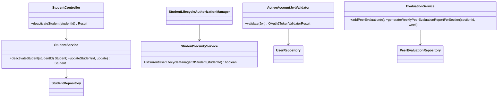
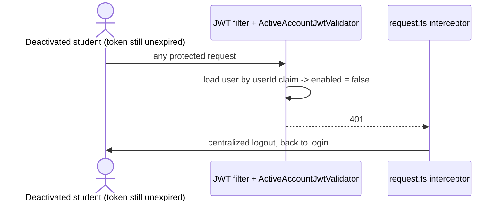

# Students (STU) Design

**Realizes:** [UC-STU-deactivate-student](../requirements/use-cases.md#uc-stu-deactivate-student-the-course-admininstructor-deactivates-a-student)
**Depends on:** [FR-SEC-active-account](../requirements/software-requirements-specification.md); business rules BR-student-lifecycle, BR-deactivation-keeps-team, BR-submission-owed, BR-evaluation-active-evaluatee, BR-evaluation-report-inclusion, BR-section-scoped-access, BR-role-based-access ([Business Rules](../requirements/business-rules.md))
**Sits under:** the foundation component view and Architectural Conventions in [architectural-design.md](architectural-design.md); the student entity is the SRS's Business Domain Model `Student` (no change)

## Overview

Deactivation becomes a dedicated, confirmed action instead of a field on the generic student edit. Three existing places are brought into line with what "deactivated" means: the per-request token check (so a session already open is refused), peer-evaluation submission, and the section's weekly peer evaluation report. Team membership is deliberately untouched (BR-deactivation-keeps-team), so no team code changes.

## Components & classes

| Layer | Component | Reused / new | Change |
|---|---|---|---|
| Security (trunk) | `security/ActiveAccountJwtValidator` | **new** | `OAuth2TokenValidator<Jwt>`: reads the `userId` claim, loads the `PeerEvaluationUser`, fails if absent or `!isEnabled()` |
| Security (trunk) | `security/SecurityConfiguration.jwtDecoder()` | reused | wraps the decoder's validator: default validators **and** `ActiveAccountJwtValidator` |
| Security | `security/authorizationmanagers/StudentLifecycleAuthorizationManager` | **new** | admits the course admin of the student's course or an instructor assigned to her course section (BR-student-lifecycle) |
| Security | `security/SecurityConfiguration` route rules | reused | `PUT /students/{studentId}/deactivate` → `StudentLifecycleAuthorizationManager` |
| Student | `student/StudentSecurityService` | reused | new `isCurrentUserLifecycleManagerOfStudent(studentId)`: course admin of `student.section.course` **or** instructor of `student.section` |
| Student | `student/StudentController` | reused | new `deactivateStudent(studentId)` |
| Student | `student/StudentService` | reused | new `deactivateStudent(studentId)`; `updateStudent` no longer lets `enabled` go `true → false` |
| Student | `student/StudentAlreadyDeactivatedException` | **new** | mapped to 409 in `system/exception/ExceptionHandlerAdvice` |
| Evaluation | `evaluation/EvaluationService.addPeerEvaluation` | reused | rejects an inactive evaluatee (`PeerEvaluationIllegalArgumentException`, 400) |
| Evaluation | `evaluation/EvaluationService.generateWeeklyPeerEvaluationReportForSection` | reused | student filter follows BR-evaluation-report-inclusion |
| Frontend | `apis/student` | reused | new `deactivateStudent(studentId)` |
| Frontend | `pages/students/Students.vue` | reused | **Deactivate** row action (active students only) → `ElMessageBox.confirm` stating the consequences |
| Frontend | `pages/students/EditStudentForm.vue` | reused | Status control shown only for an inactive student (reactivation path until UC-STU-reactivate-student is built) |



## Sequence

Main success scenario (UC steps in the notes):

```mermaid
sequenceDiagram
    actor I as Instructor / course admin
    participant UI as Students.vue
    participant F as JWT filter + ActiveAccountJwtValidator
    participant A as StudentLifecycleAuthorizationManager
    participant C as StudentController
    participant S as StudentService
    I->>UI: choose Deactivate on a student (steps 1-3)
    UI->>I: warning listing the consequences, ask to confirm (step 4)
    alt cancel (5a)
        I->>UI: Cancel
        Note over UI: no request sent; nothing changes
    else confirm (step 5)
        I->>UI: Confirm
        UI->>F: PUT /students/{id}/deactivate (Bearer)
        F->>F: caller's account still active?
        F->>A: authorize
        A-->>F: course admin of course OR instructor of section? (else 403, 3b)
        F->>C: deactivateStudent(id)
        C->>S: deactivateStudent(id)
        S->>S: already inactive? (409, 3a)
        S->>S: enabled = false; team unchanged
        S-->>C: Student
        C-->>UI: 200 + StudentDto
        UI->>I: "student deactivated" (step 6)
    end
```

The deactivated student's own next request (FR-SEC-active-account):



## API contract

| Method & path | Who may call | Request | Success | Errors |
|---|---|---|---|---|
| `PUT /api/v1/students/{studentId}/deactivate` | course admin of the student's course, or an instructor assigned to her course section | no body | 200, the deactivated student | 403 not authorized (3b; the UI tells her to contact the course admin of the student's course) · 409 already deactivated (3a) · 403 no such student (the route rule refuses before the service runs, so the response does not reveal which ids exist; see `AuthorizationRuleIntegrationTest`) |
| `PUT /api/v1/students/{studentId}` (changed) | unchanged | unchanged | unchanged | `enabled: false` on an active student is ignored (the value is not applied); `false → true` still applies |
| every protected route (changed) | — | — | — | 401 when the token's account is inactive or no longer exists |

## Key decisions

- **Check the account on every request, at token validation.** Rejected: a shorter token lifetime (still leaves a window, which FR-SEC-active-account forbids) and a token denylist (new state to store and expire). Cost: one primary-key lookup per request. Side effect, wanted: a deactivated instructor (BR-instructor-lifecycle) is cut off the same way.
- **Deactivation has exactly one path, the confirmed one.** The generic edit can no longer turn an account off, otherwise the warning in step 4 is bypassable. Rejected: removing the Status control entirely (it is the only reactivation path until UC-STU-reactivate-student is built); leaving it (keeps the bypass).
- **Authorization includes the course admin explicitly.** `isCurrentUserInstructorOfStudentSection` checks only `section.instructors`; a course admin not assigned to that course section would be refused, contradicting BR-student-lifecycle. The new check is admin-of-course **or** instructor-of-section.
- **Team membership untouched** (BR-deactivation-keeps-team). Rejected: removing her from the team, which an instructor may not do (BR-team-admin-only) and which would drop her past weeks from team-scoped records.
- **Report inclusion keys on evidence, not a date** (BR-evaluation-report-inclusion). Rejected: a `deactivated_at` column (migration, and reactivation must decide what to do with it).
- **3b message lives in the UI.** The 403 comes from the shared access-denied handler, which stays generic for every route. The shared `request.ts` interceptor still routes every 403 to the forbidden page; `Students.vue` adds an alert naming the course admin on top of it rather than changing the interceptor for every caller. In practice an instructor only lists her own course section's students, so the UI rarely reaches 3b; the API refusal is what the tests pin.

## Data model

No change.

## Reuse & cross-cutting

Reuses the JWT resource-server chain, the deny-by-default route table, `ExceptionHandlerAdvice` / `Result`, and the frontend `request.ts` 401 logout. `SubmissionStatusService.findOwedItems` already applies BR-submission-owed and is unchanged.

## Tests

| # | Flow | Level | Asserts |
|---|---|---|---|
| T1 | Main: section instructor deactivates an active student | integration | 200; student `enabled = false`; her team unchanged |
| T2 | Main: course admin **not** assigned to the course section deactivates | unit + integration | 200 |
| T3 | 3a: student already deactivated | unit + integration | 409; account unchanged |
| T4 | 3b: instructor of another course section, and a student, try | integration | 403; account unchanged |
| T5 | 5a: cancel at the warning | **manual** | no request sent; student still active (no frontend test harness is used) |
| T6 | FR-SEC-active-account: token issued before deactivation | integration | next protected request → 401 |
| T7 | Same for a deactivated instructor's token | integration | 401 |
| T8 | BR-evaluation-active-evaluatee: new evaluation of an inactive student | unit | rejected, not saved |
| T9 | BR-evaluation-active-evaluatee: edit of an evaluation of her submitted earlier | unit | saved |
| T10 | BR-evaluation-report-inclusion | unit | inactive + evaluated that week → listed; inactive + not evaluated → omitted; active + not evaluated → listed |
| T11 | BR-submission-owed: teammates owe no evaluation of her | integration | teammate who rated only active members is not owing (already covered before this use case by `SubmissionStatusServiceIntegrationTest.testAnEvaluationOfADeactivatedTeammateIsNotRequired`; no new test) |
| T12 | Generic edit cannot deactivate | unit | `updateStudent` with `enabled = false` leaves an active student active |

## Open questions / risks

- The per-request lookup adds one query to every request; acceptable at course scale, revisit if PER-* thresholds are threatened.
- No frontend automated test covers the confirm dialog or 5a (T5 is manual).
